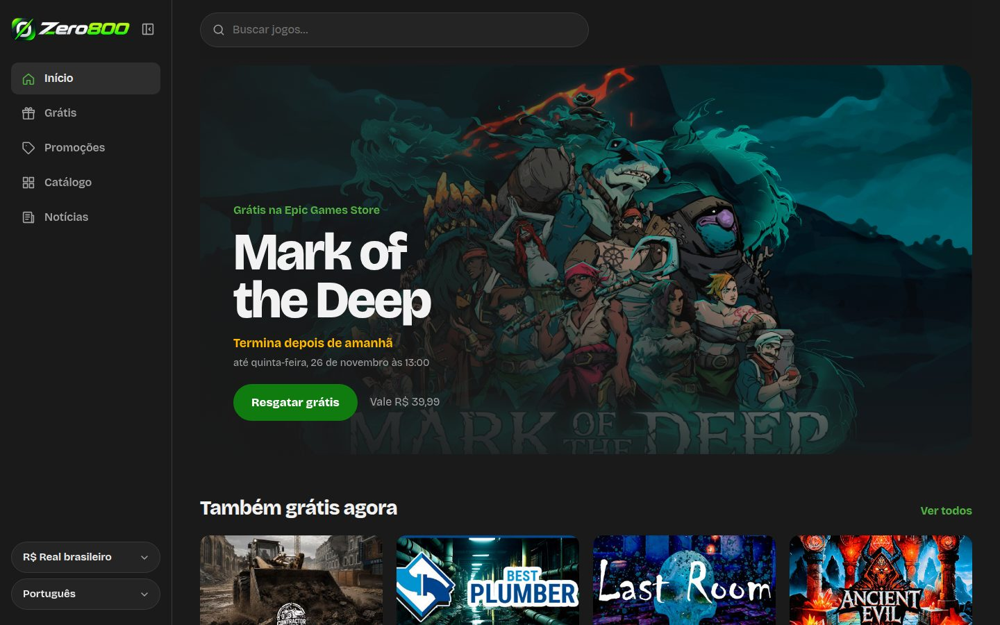
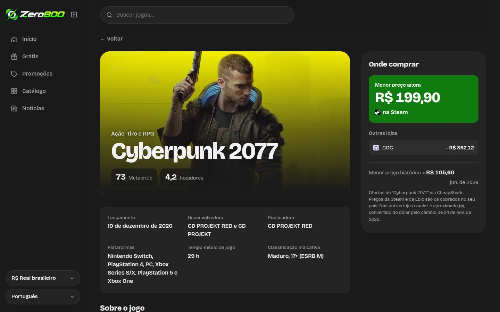
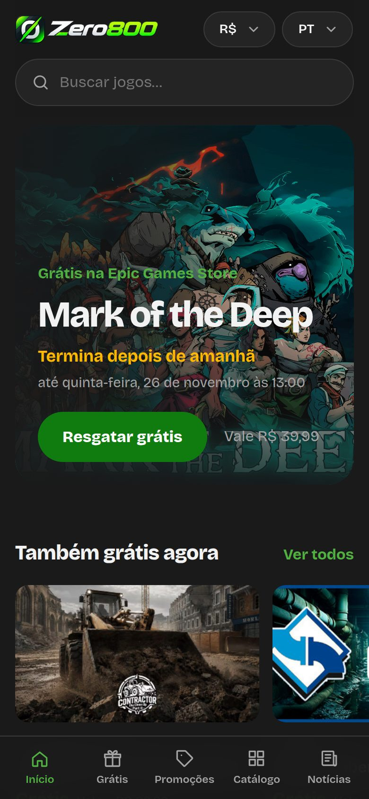
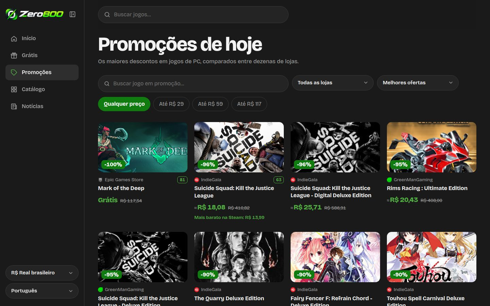
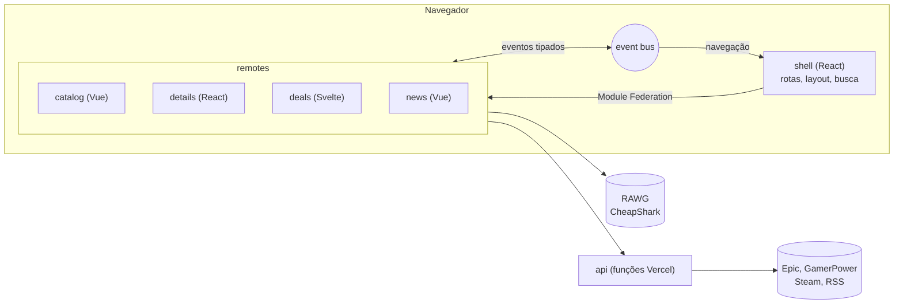

<p align="center">
  
</p>

<p align="center">
  <strong>Jogos grátis para resgatar, promoções de PC e notícias de games, com preço na sua moeda.</strong><br />
  <sub>"0800" é como o brasileiro chama o que sai de graça.</sub>
</p>

<p align="center">
  <a href="https://github.com/jonathanFranco/zero800/actions/workflows/ci.yml"></a>
  
  
  
  
  
  
  
</p>

<p align="center">
  
</p>

---

## O que tem no site

- **Grátis agora.** Os jogos de PC grátis na Epic, Steam, GOG, itch.io e outras lojas, com o prazo para resgatar ("Termina depois de amanhã") e quanto o jogo vale.
- **Em breve na Epic.** Os próximos grátis da Epic, anunciados uma semana antes.
- **Promoções.** Os maiores descontos de dezenas de lojas, com filtros por loja, preço máximo e ordenação.
- **Preço de verdade.** Real, dólar ou euro. Preços da Steam e da Epic são os cobrados no seu país; o site avisa quando a Steam brasileira está mais barata que a oferta.
- **Página do jogo.** Onde comprar mais barato, menor preço histórico, ficha técnica, capturas de tela e descrição traduzida pelo próprio navegador.
- **Notícias.** Matérias dos principais portais de games, no idioma escolhido.
- **Português, inglês e espanhol**, com busca global, menu lateral recolhível no desktop e abas fixas no celular.

<table>
  <tr>
    <td width="62%"></td>
    <td width="38%" rowspan="2"></td>
  </tr>
  <tr>
    <td></td>
  </tr>
</table>

## Como funciona

Cada parte da tela é uma aplicação independente, em um framework diferente, com build e deploy próprios. O `shell` junta tudo no navegador com **Module Federation**.

| App | Framework | Porta | O que faz |
|---|---|---|---|
| `shell` | React 19 | 4000 | Layout, rotas, busca global, idioma e moeda, SEO por página |
| `catalog` | Vue 3 | 4001 | Catálogo com busca, gêneros e ordenação ([RAWG](https://rawg.io/apidocs)) |
| `details` | React 19 | 4002 | Página do jogo: notas, ficha técnica, capturas, descrição traduzida |
| `deals` | Svelte 5 | 4003 | Grátis, vitrine de promoções e "onde comprar" ([CheapShark](https://apidocs.cheapshark.com/)) |
| `news` | Vue 3 | 4004 | Lista e página de notícias, com o jogo citado na matéria |
| `api` | Funções Vercel | 4010 | Fontes que bloqueiam o navegador: Epic, GamerPower, Steam e RSS dos portais |



### Decisões de arquitetura

<details>
<summary><strong>Contrato de montagem igual para qualquer framework</strong></summary>

Todo remote expõe a mesma função ([`mount.ts`](packages/shared/src/mount.ts)):

```ts
type MountFn<P> = (el: HTMLElement, props: P) => () => void;
```

O shell entrega um `<div>` e recebe a função de desmontagem. Trocar o framework de um app não muda nada no shell.
</details>

<details>
<summary><strong>Comunicação só por eventos tipados</strong></summary>

Os apps não importam uns aos outros nem compartilham store. O contrato fica em [`events.ts`](packages/shared/src/events.ts): `game:selected`, `game:loaded`, `news:selected`, `locale:changed`, `currency:changed` e outros. O bus guarda o último valor de cada evento, então a ordem em que os apps terminam de carregar não importa.
</details>

<details>
<summary><strong>Falha isolada</strong></summary>

[`RemoteMount`](apps/shell/src/components/RemoteMount.tsx) captura erro de rede ou de montagem e mostra "Tentar de novo" só naquele pedaço da tela. Se o `deals` cair, a página do jogo continua de pé. Para ver: rode `npm run dev`, encerre o processo do `deals` e abra um jogo.
</details>

<details>
<summary><strong>Um design system para todos os frameworks</strong></summary>

[`tokens.css`](packages/shared/src/tokens.css) define cores, raios, fonte e as peças comuns (capas, grades, prateleiras e selects). Cada app usa CSS escopado por cima, sem vazar estilo para os outros. React é compartilhado como singleton entre `shell` e `details`; Vue e Svelte só carregam onde são usados.
</details>

<details>
<summary><strong>Preços, moedas e idiomas</strong></summary>

- **Moeda:** segue o idioma até você escolher uma. Steam e Epic usam o preço regional real; as outras lojas informam em dólar e o valor é convertido pelo câmbio do Banco Central Europeu ([Frankfurter](https://frankfurter.dev/)), marcado com "≈".
- **Idioma:** estado em [`i18n.ts`](packages/shared/src/i18n.ts). Cada app tem o próprio dicionário, tipado para que os três idiomas tenham as mesmas chaves. Gêneros e classificação etária vêm traduzidos; a descrição dos jogos usa o tradutor embutido do Chrome, com o Google Tradutor como alternativa.
</details>

## Rodando localmente

Requer Node `20.19+` ou `22.12+` e uma chave grátis da [RAWG](https://rawg.io/apidocs).

```bash
git clone https://github.com/jonathanFranco/zero800.git
cd zero800
cp .env.example .env     # coloque a chave em VITE_RAWG_KEY
npm install
npm run dev              # sobe a API e os 5 apps
```

Abra **http://localhost:4000**.

Cada app também roda sozinho, sem o shell:

| Comando | Endereço |
|---|---|
| `npm run dev -w @gamevault/catalog` | http://localhost:4001 |
| `npm run dev -w @gamevault/details` | http://localhost:4002/?slug=hades |
| `npm run dev -w @gamevault/deals` | http://localhost:4003 ou `/?name=Hades` |
| `npm run dev -w @gamevault/news` | http://localhost:4004 (precisa da `api`) |
| `npm run dev -w @gamevault/api` | http://localhost:4010/api/free-games |

| Script | O que faz |
|---|---|
| `npm run dev` | Todos os apps em modo dev |
| `npm run build` | Build de produção de todos, com cache |
| `npm run preview` | Gera os builds e serve, para testar a federação como em produção |
| `npm run typecheck` | `tsc`, `vue-tsc` e `svelte-check` em cada app, com cache |
| `npx turbo dev --filter=@gamevault/deals` | Só um app (troque o nome) |

As tarefas rodam pelo [Turborepo](https://turborepo.com) ([`turbo.json`](turbo.json)): em paralelo, na ordem das dependências e com cache. Rodar o build de novo sem mudar nada leva milissegundos.

## Deploy

Cada app é um projeto separado na Vercel e é publicado de forma independente pelo GitHub Actions ([`ci.yml`](.github/workflows/ci.yml)). Todo push e pull request passa por typecheck e build (com o cache do Turborepo guardado entre execuções); num push na `master`, só os apps afetados vão para produção. Quem decide é o `turbo ls --affected`, a partir das dependências entre os pacotes, então um app novo entra na regra sem mexer no workflow.

| O que mudou | O que é publicado |
|---|---|
| `apps/<app>/` | só esse app |
| `packages/shared/` | os 5 apps de tela (a API não usa o `shared`) |
| `package.json` da raiz, `tsconfig.base.json` ou `turbo.json` | todos |
| só documentação ou o workflow | nada (use *Run workflow* se precisar) |

Para publicar à mão: **Actions → CI / Deploy → Run workflow**, informando os apps (`shell,deals`) ou `all`.

<details>
<summary><strong>Configuração inicial (uma vez)</strong></summary>

**1. Vercel.** Crie 6 projetos importando este repositório, um por app, com o **Root Directory** correspondente (`apps/shell`, `apps/catalog`, `apps/details`, `apps/deals`, `apps/news`, `apps/api`). No `api`, use o Framework Preset **Other**. Não precisa desligar o deploy automático da Vercel: o `vercel.json` de cada app já tem `"git": { "deploymentEnabled": false }`, então só o GitHub Actions publica. A importação pode gerar um primeiro deploy na hora; ele é substituído no primeiro deploy pelo Actions.

**2. Secrets do GitHub** (*Settings → Secrets and variables → Actions → Secrets*):

| Secret | Onde pegar |
|---|---|
| `VERCEL_TOKEN` | Vercel → Account Settings → Tokens |
| `VERCEL_ORG_ID` | *Team ID* nas configurações do time ou da conta |
| `VERCEL_PROJECT_ID_SHELL`, `_CATALOG`, `_DETAILS`, `_DEALS`, `_NEWS`, `_API` | *Project ID* em Settings → General de cada projeto |
| `VITE_RAWG_KEY` | rawg.io/apidocs |

**3. Variables do GitHub** (mesma tela, aba *Variables*), sem barra no final:

| Variable | Exemplo |
|---|---|
| `SITE_URL` | `https://zero800.com.br` |
| `API_URL` | `https://zero800-api.vercel.app` |
| `CATALOG_URL`, `DETAILS_URL`, `DEALS_URL`, `NEWS_URL` | `https://zero800-catalog.vercel.app` etc. |

Se faltar algum, o deploy para no primeiro passo dizendo qual.

Não é preciso cadastrar variáveis no painel da Vercel: o workflow usa sempre os valores do GitHub, mesmo que exista uma variável com o mesmo nome por lá.
</details>

## SEO

- Título, descrição e link canônico por página, com o nome do jogo ou da notícia.
- Imagem de compartilhamento, Open Graph e Twitter Card.
- `sitemap.xml` e `robots.txt` gerados no build a partir de `VITE_SITE_URL`.
- Dados estruturados (`WebSite` com busca), manifest e ícones para instalar no celular.
- Buscas e página 404 ficam fora do índice.

O site é renderizado no navegador. O Google executa JavaScript e vê cada página; prévias de link no WhatsApp e no Discord mostram os dados gerais do site.

## Estrutura

```
zero800/
├── apps/
│   ├── shell/      React (host): rotas, layout, RemoteMount, SEO
│   ├── catalog/    Vue: ./mount
│   ├── details/    React: ./mount
│   ├── deals/      Svelte: ./mount, ./feed, ./free
│   ├── news/       Vue: ./mount, ./article
│   └── api/        funções Vercel (api/*.ts), servidas pelo Vite em dev
├── packages/
│   └── shared/     contratos de eventos e montagem, i18n, moeda, design tokens
├── docs/screenshots/
├── turbo.json
└── .github/workflows/ci.yml
```

## Próximos passos

- [ ] Lista de jogos "jogando, zerado, quero jogar" (novo app)
- [ ] Alerta quando um jogo da lista ficar grátis ou baixar de preço
- [ ] Manifest de remotes carregado em runtime, para trocar versão sem rebuild do shell
- [ ] Testes E2E com Playwright cobrindo o fluxo entre apps
- [ ] Prévias de link por jogo, com renderização no servidor

## Créditos

Dados de jogos por [RAWG](https://rawg.io/). Preços por [CheapShark](https://www.cheapshark.com/) e Steam. Jogos grátis pela Epic Games Store e [GamerPower](https://www.gamerpower.com/). Câmbio por [Frankfurter](https://frankfurter.dev/). Notícias pelos portais citados em cada matéria. Zero800 não tem relação com nenhuma dessas lojas ou serviços.
